# PCAP Forensic Analyzer

An interactive cybersecurity tool for automated analysis of **PCAP** and **PCAPNG** network captures. The project complements Wireshark by automating repetitive digital forensics and incident response (DFIR) tasks such as threat detection, IOC extraction, credential analysis, forensic reporting, and traffic visualization.

---

## Why this exists

Wireshark is an industry-standard packet analyzer and excels at protocol-level inspection. However, forensic investigations often require additional manual effort to identify suspicious activity, extract Indicators of Compromise (IOCs), triage cleartext credentials, and prepare investigation reports.

This project focuses on **automating those investigation tasks**, enabling faster triage of packet captures while still allowing analysts to use Wireshark for deep packet inspection when required.

| Manual Wireshark Workflow | PCAP Forensic Analyzer |
|---------------------------|------------------------|
| Manual packet inspection | Automated traffic analysis dashboard & packet viewer |
| Manual IOC extraction | One-click extraction of external IPs, domains, and URLs |
| Manual report writing | Automatic Markdown & integrity-verifiable PDF forensic report generation |
| Manual threat hunting | Heuristic rule-based triage modules (Port Scan, Beaconing, DNS Tunneling, Plaintext Credentials) |
| Limited visualization | Interactive charts, traffic timeline, and network communication graph |
| Requires display-filter expertise | Beginner-friendly Security Operations Center (SOC) style dashboard |

---

## Technology Stack

- **Core & Parsing:** Python 3.10+, [Scapy](https://scapy.net/) (packet decoding & synthesis)
- **Frontend & UI:** [Streamlit](https://streamlit.io/) (responsive SOC theme with dark/light mode toggle), [Plotly Express & Graph Objects](https://plotly.com/python/) (interactive visualizations)
- **Network Analysis:** [NetworkX](https://networkx.org/) (host communication topology), [Pandas](https://pandas.pydata.org/) (statistical aggregation)
- **Forensic Reporting & Integrity:** [ReportLab](https://www.reportlab.com/) (multi-page PDF generation), Cryptographic hashing (`hashlib` MD5, SHA-1, SHA-256 with sidecars)
- **Extensibility (Optional):** [FastMCP](https://github.com/jlowin/fastmcp) (Optional Model Context Protocol server for AI assistant integrations)
- **Optional Acceleration:** Optional Rust acceleration (`rust/`) for Shannon entropy calculation and graph edge counting (Scapy handles packet parsing), with an automatic pure-Python fallback when the native extension is unavailable

---

## Features

### 1. Packet Analysis & Triage
- Upload and analyze **PCAP** and **PCAPNG** captures.
- Automatic packet parsing with protocol classification (TCP, UDP, ICMP, DNS, HTTP, TLS, ARP).
- Comprehensive traffic statistics: total packets, byte volume, duration, packet rates, unique endpoints, and active sessions.
- Bidirectional host conversation aggregation and Top Talkers analysis.
- Interactive Packet Inspector with hex/ASCII payload dumps.

### 2. Rule-Based Threat Detection & Triage
The analyzer inspects traffic for suspicious patterns, providing heuristic, rule-based triage indicators to prioritize investigation:
- **Port Scan Detection:** Flags potential reconnaissance activity when a source contacts many distinct destination ports within a short time window.
- **C2 Beaconing Detection:** Highlights suspicious periodic communication patterns using connection interval timing and jitter variance.
- **DNS Tunneling Detection:** Flags potential data exfiltration or tunneling based on high subdomain query volume and elevated Shannon entropy.
- **Plaintext Credential Exposure:** Surfaces unencrypted credentials transmitted in cleartext over HTTP POST forms, HTTP Basic Auth, FTP, or Telnet.

> [!NOTE]
> All detection alerts represent heuristic triage indicators to guide forensic investigation, not definitive proof of an attack or compromise. Benign traffic (such as routine network discovery, cloud telemetry polling, or content distribution) can generate similar patterns and may produce false positives that require manual validation.

### 3. Password Forensics & Triage
- Specialized credential inspector identifying exposed usernames, passwords, and tokens.
- Weak and default password triage against curated forensic wordlists.
- Credential reuse tracking across multiple destination hosts.
- Sensitive value masking toggle for secure screen sharing.
- Downloadable CSV export of findings.

### 4. Indicators of Compromise (IOC) Extraction
- Automated extraction of external IP addresses, domain names, and URLs.
- RFC 1918 / RFC 5737 filtering to separate internal traffic from external indicators.
- One-click CSV export of extracted IOCs.

### 5. Evidence Integrity & Cryptographic Sidecars
- Cryptographic hash generation for uploaded evidence captures (MD5, SHA-1, SHA-256).
- Detached SHA-256 integrity sidecars (`<report>.pdf.sha256`) generated automatically upon PDF export, containing `pdf_filename`, `sha256`, `generated_at_utc`, and a unique `report_id`.
- Both in-dashboard UI verification and standalone CLI audit utility (`hash_verifier.py`) to confirm exported reports match their recorded hash and have not been altered or corrupted after export.
- Reports avoid circular hash mutation by keeping hashes in external sidecars rather than asserting self-referential checksums internally.

> [!NOTE]
> SHA-256 sidecars help verify whether an exported report matches its recorded checksum and has not suffered accidental modification or corruption. They do not constitute a cryptographic digital signature, trusted timestamp authority, or complete legal chain-of-custody system.

### 6. Dual-Format Forensic Reporting
- **PDF Report Generation:** Professional multi-page forensic report built with ReportLab, featuring case metadata, evidence summaries, severity charts, threat alert breakdowns, and an accompanying detached `.sha256` integrity sidecar.
- **Markdown Report Generation:** Structured report export for documentation and integration with case management tools.

### 7. Interactive SOC-Themed Dashboard
- Modern SOC dashboard with seamless Dark (`#0B1120`) and Light (`#F4F7FB`) theme toggles.
- Glassmorphism overview metric cards with readable typography and live calculations.
- Semantic HTML data tables with sticky headers and scrollable containers.
- Plotly charts with unified cyan/blue palettes and custom themed tooltips.
- Host communication topology graph powered by NetworkX and Plotly.
- Second-by-second packet rate (PPS) and bandwidth consumption timeline charts.

### 8. Model Context Protocol (MCP) Server (Experimental & Optional)
- Optional, experimental FastMCP server (`mcp_server/server.py`) designed to allow AI assistants (such as Claude Desktop) to invoke PCAP parsing, statistics, IOC extraction, and threat detectors over stdio.
- *Optional feature:* The core Streamlit dashboard, CLI triage (`main.py`), and automated test suites do not require the MCP server and run completely independently.
- *Compatibility note:* Implemented with the FastMCP v1 SDK; requires `pip install 'mcp<2'` (incompatible with `mcp>=2.0` installed in the current environment without pinning).

---

## Project Structure

```
pcap-analyzer/
├── app.py                         # Streamlit forensic dashboard entry point
├── main.py                        # Command-line interface (CLI) entry point
├── config.py                      # Application configuration & feature flags
├── models.py                      # PacketRecord and alert dataclass definitions
├── pcap_parser.py                 # PCAP/PCAPNG packet parser (Scapy)
├── calculate_statistics.py        # Traffic metrics, talkers, conversations
├── communication_graph.py         # Network communication graph (NetworkX + Plotly)
├── hashing.py                     # Cryptographic hashing (MD5, SHA-1, SHA-256)
├── hash_verifier.py               # Evidence integrity validation utilities
├── ioc_extractor.py               # IOC extraction (IPs, domains, URLs)
├── password_detector.py           # Cleartext credential exposure & triage
├── credential_utils.py            # Basic auth decoding, JWT recognition, triage dicts
├── report_generator.py            # Structured Markdown forensic report generator
├── pdf_report.py                  # Professional PDF report export (ReportLab)
├── report_integrity.py            # Cryptographic sidecars & tamper verification
├── performance.py                 # In-memory caching & profiling layer
├── accelerated.py                 # Accelerated entropy & graph edge aggregation
├── design_system.py               # Design tokens, CSS variables & dark theme
├── ui_styles.py                   # Light theme tokens & CSS variables
├── theme_manager.py               # Theme switcher and CSS injector
├── ui_components.py               # Reusable UI cards, tables, banners
│
├── assets/
│   └── theme.css                  # Enterprise SOC theme stylesheet
│
├── detectors/
│   ├── __init__.py
│   ├── port_scan.py               # Port scan detection module
│   ├── beaconing.py               # C2 beaconing detection module
│   ├── dns_tunneling.py           # DNS tunneling & entropy detection module
│   └── plaintext_creds.py         # Insecure credentials detection module
│
├── mcp_server/
│   ├── __init__.py
│   ├── server.py                  # FastMCP server entry point (stdio)
│   └── tools.py                   # MCP forensic tool handlers
│
├── rust/
│   ├── Cargo.toml                 # Optional Rust acceleration package
│   └── src/lib.rs                 # Native Rust routines for entropy & graph edge aggregation
├── rust_bridge.py                 # PyO3 bridge with transparent pure-Python fallback
│
├── samples/
│   ├── README.md                  # Sample data documentation
│   └── generate_sample_pcap.py    # Synthetic PCAP test capture generator
│
├── reports/
│   └── .gitkeep                   # Target directory for generated reports
│
├── screenshots/                   # Application demonstration screenshots
│
├── tests/
│   ├── test_accelerated.py        # Acceleration & graph parity tests
│   ├── test_dashboard_improvements.py # Parsing, hex view, & filter tests
│   ├── test_detectors.py          # Threat detection module tests
│   └── test_regressions.py        # Theme, card, table, & integrity regression tests
│
├── .gitignore                     # Git exclusion rules
├── requirements.txt               # Python package dependencies
└── README.md                      # Project documentation
```

---

## Installation & Setup

### Prerequisites
- **Python 3.10+** installed on your system.
- **Git** for version control.

### Setup Instructions (Windows PowerShell)

1. **Clone the repository:**
   ```powershell
   git clone https://github.com/Anshikatripathi-13/pcap_analyzer.git
   cd pcap_analyzer
   ```

2. **Create and activate a virtual environment:**
   ```powershell
   python -m venv .venv
   .\.venv\Scripts\Activate.ps1
   ```

3. **Install dependencies:**
   ```powershell
   pip install -r requirements.txt
   ```

---

## Usage

### 1. Launch the Streamlit Dashboard (Recommended)

Start the interactive dashboard using:
```powershell
.\.venv\Scripts\python -m streamlit run app.py
```
Or, if your virtual environment is activated:
```bash
streamlit run app.py
```
The application will open automatically in your browser at `http://localhost:8501`.

### 2. Command-Line Interface (CLI)

#### Automated Capture Triage (`main.py`)

Run automated triage on a capture and optionally generate a Markdown report directly from the terminal without launching the web UI:
```powershell
# Run triage and export a Markdown report
.\.venv\Scripts\python main.py samples/synthetic_investigation.pcap --report reports/investigation_report.md

# Run triage and print summary alert table to console
.\.venv\Scripts\python main.py samples/synthetic_investigation.pcap
```

#### Forensic Report Integrity Verification (`hash_verifier.py`)

Verify an exported PDF forensic report against its detached `.sha256` sidecar file from the command line:
```powershell
# Verify PDF with explicit sidecar path
.\.venv\Scripts\python hash_verifier.py pcap_forensic_report.pdf pcap_forensic_report.pdf.sha256

# Verify PDF with automatic sidecar resolution (looks for <filename>.sha256 alongside the PDF)
.\.venv\Scripts\python hash_verifier.py pcap_forensic_report.pdf
```

---

### 3. Model Context Protocol (MCP) Server (Experimental & Optional)

> [!WARNING]
> **Optional Dependency Compatibility Notice:**
> The MCP server is entirely optional; core application features, CLI tools, test suites, and the Streamlit dashboard do not require the MCP server to run.
> The experimental MCP server (`mcp_server/server.py`) was developed against the Model Context Protocol SDK v1 interface (`from mcp.server.fastmcp import FastMCP`).
> In the project's current virtual environment, `mcp>=2` is installed (`mcp==2.3.0`), where FastMCP was renamed to `MCPServer`, raising:
> ```text
> ModuleNotFoundError: No module named 'mcp.server.fastmcp'
> ```
> To run the optional MCP server, pin or downgrade to FastMCP v1:
> ```powershell
> pip install "mcp<2"
> ```

Once FastMCP v1 is installed (`pip install "mcp<2"`), you can start the server via stdio:
```powershell
.\.venv\Scripts\python -m mcp_server.server
```

Add the following to your `claude_desktop_config.json` to integrate with Claude Desktop:
```json
{
  "mcpServers": {
    "pcap-analyzer": {
      "command": "C:\\Users\\<User>\\...\\pcap-analyzer\\.venv\\Scripts\\python.exe",
      "args": ["-m", "mcp_server.server"],
      "cwd": "C:\\Users\\<User>\\...\\pcap-analyzer"
    }
  }
}
```

---

## Synthetic Test Capture

The project includes an automated synthetic capture generator (`samples/generate_sample_pcap.py`) that synthesizes benign web traffic alongside five threat scenarios:
- Benign DNS, HTTP, and TLS handshakes
- SYN Port Scan (16 ports)
- Periodic C2 Beaconing (5.0s intervals)
- High-Entropy DNS Tunneling
- Plaintext HTTP POST form and FTP authentication credentials

### Regenerating the Test Capture

To generate or refresh the synthetic test capture:
```powershell
.\.venv\Scripts\python samples/generate_sample_pcap.py
```
This generates `samples/synthetic_investigation.pcap` (103 packets, ~12 KB), which is used by the test suite for automated end-to-end testing.

> [!IMPORTANT]
> All IP addresses in the synthetic capture use RFC 5737 documentation ranges (`198.51.100.0/24`, `203.0.113.0/24`) and RFC 1918 private ranges (`192.168.1.0/24`, `10.0.0.0/8`). No real, proprietary, or private network traffic is included.

---

## Running Tests

The test suite covers threat detectors, data models, report integrity, acceleration parity, and UI component rendering.

To execute the full test suite:
```powershell
.\.venv\Scripts\python -m pytest
```

> [!NOTE]
> If running tests on a clean clone where `samples/synthetic_investigation.pcap` is not present, regenerate it first using `.\.venv\Scripts\python samples/generate_sample_pcap.py`.

### Latest Test Suite Status
All **60 unit and regression tests** pass:
```text
============================= 60 passed in 15.70s =============================
```

---

## Security & Privacy Guidelines

When using this application for forensic investigations:

1. **Never commit real evidence:** Real-world PCAP/PCAPNG captures, memory dumps, and confidential network data must never be committed to Git or pushed to public repositories.
2. **Repository ignore rules:** The repository's [`.gitignore`](.gitignore) is hardened to automatically exclude `*.pcap`, `*.pcapng`, `*.cap`, `*.dmp`, `evidence/`, `captures/`, `.env`, private keys (`*.key`, `*.pem`), and generated investigation exports (`reports/*.pdf`, `reports/*.sha256`, `credential_findings.csv`, `external_ips.csv`).
3. **Git ignore scope:** Remember that `.gitignore` only prevents untracked files from being staged; it cannot un-track files that were already committed. Always inspect `git status` before committing.
4. **Public demonstrations:** For demonstrations, screenshots, and evaluations, always use synthetic captures generated via `samples/generate_sample_pcap.py`.

---

## Screenshots

Screenshots of the application:

- **Dashboard Overview**
  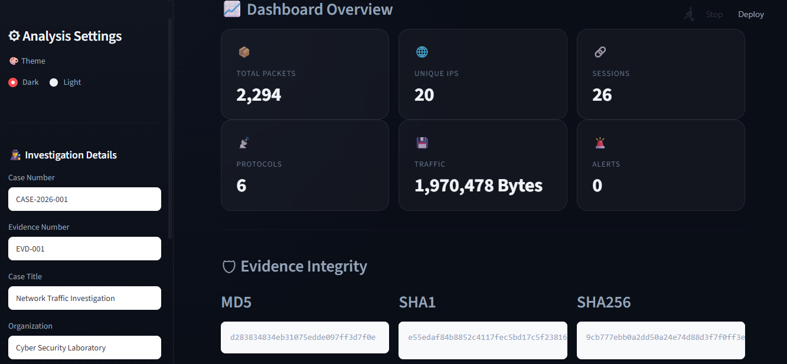

- **PCAP Forensic Analyzer Main View**
  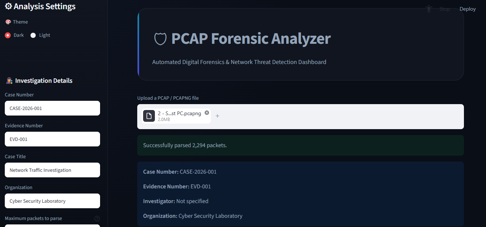

- **Traffic Statistics**
  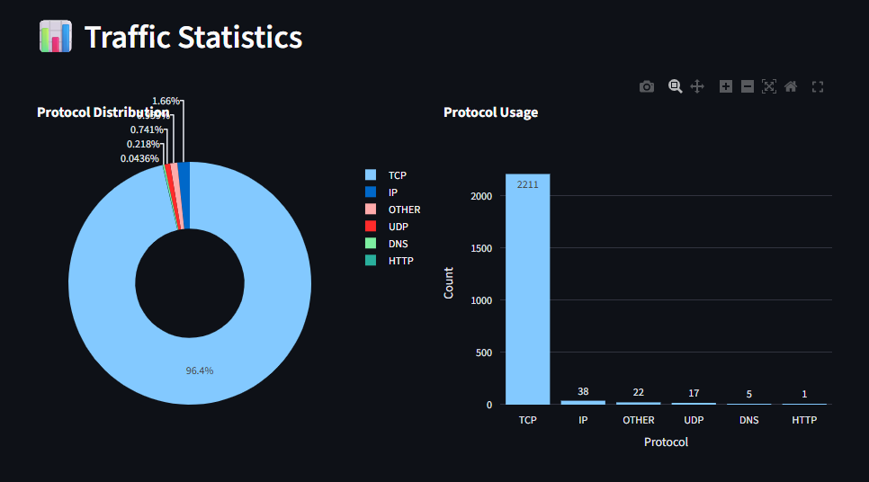

- **Threat Detection**
  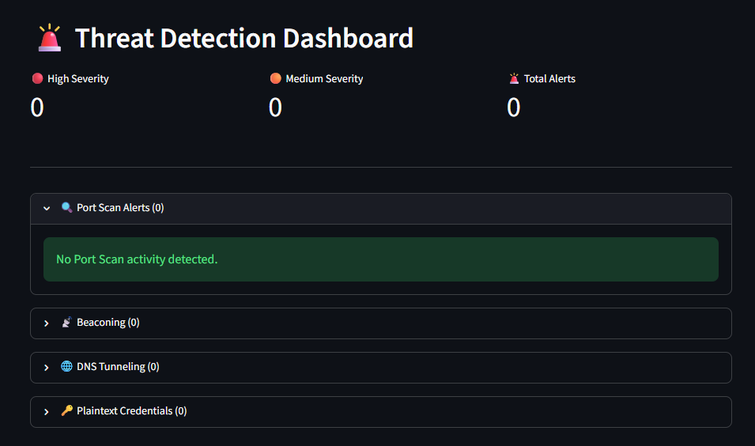

- **Credential & Password Triage**
  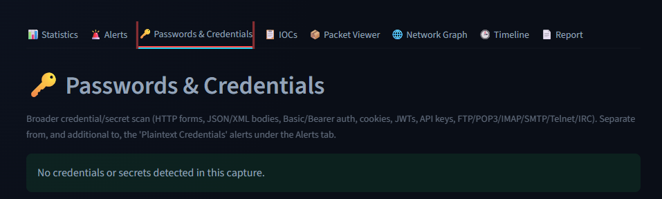

- **IOC Extraction**
  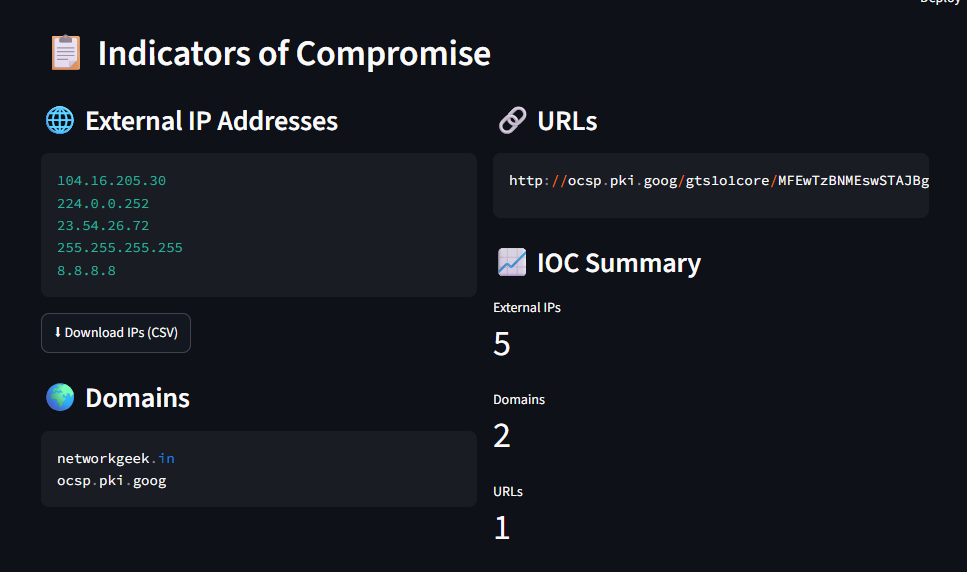

- **Packet Viewer**
  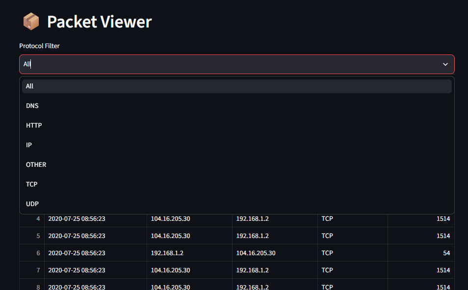

- **Evidence Integrity Verification**
  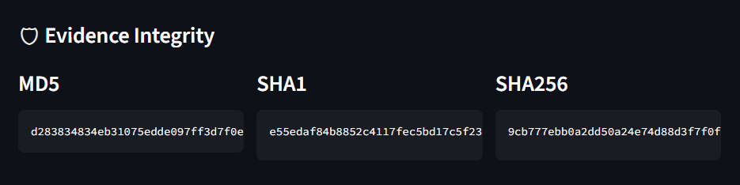

- **Network Communication Graph**
  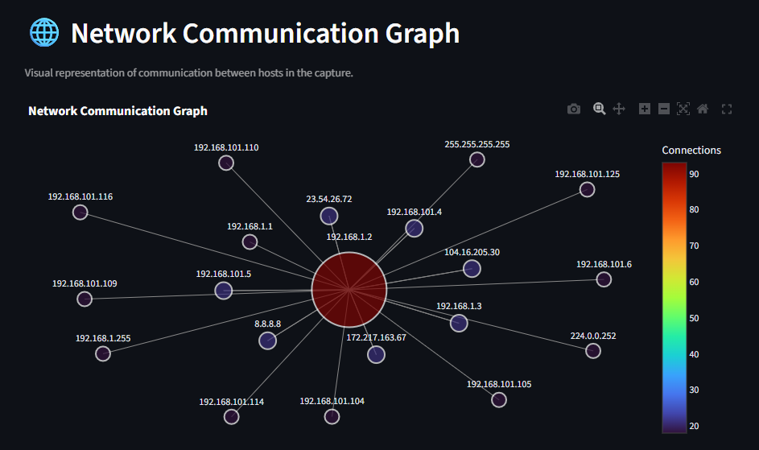

- **Traffic Timeline**
  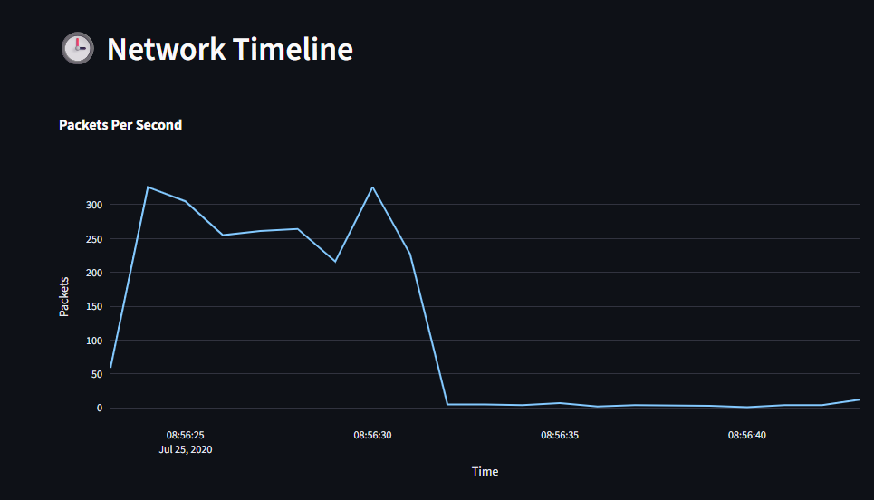

- **Investigation Report View**
  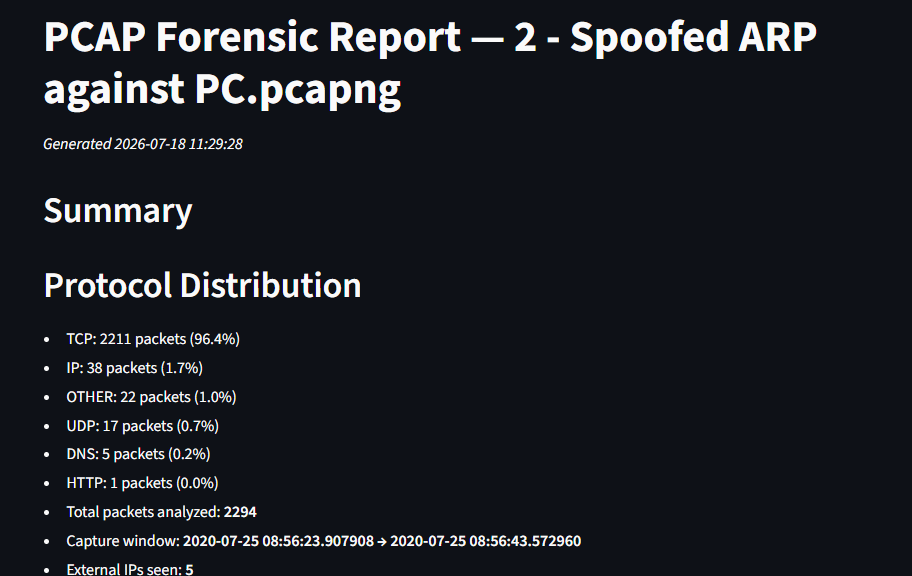

- **PDF Report Generation**
  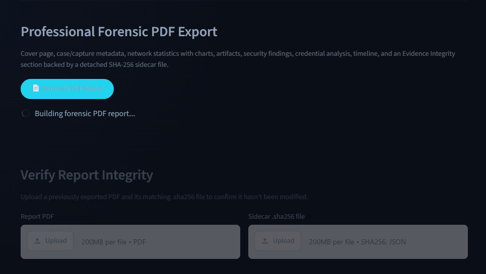

---

## Future Enhancements (Planned)

- Live packet capture via Npcap / libpcap sockets
- Geo-IP visualization and mapping of external hosts
- Threat intelligence API enrichment (VirusTotal, AbuseIPDB)
- Machine Learning based traffic anomaly detection
- Additional protocol detectors:
  - ARP Spoofing / Poisoning
  - Rogue DHCP Detection
  - Encrypted SNI / JA3 fingerprinting

---

## AI-Assisted Development

This project was developed with the assistance of multiple AI coding assistants. Each tool was used for different stages of development and verification:

- **ChatGPT:** Project planning, architecture guidance, Streamlit dashboard development, and report generation improvements.
- **Claude:** Multi-file code reasoning, detector logic refinement, and architecture recommendations.
- **Google Gemini / Antigravity:** UI theming refinement, bug fixing, test suite expansion, security auditing, and repository hardening.

> AI-generated suggestions were reviewed, tested, and integrated manually. All functionality was validated through testing with multiple PCAP files before finalizing the project.

---

## Contributing

Contributions are welcome. Areas for enhancement include:
- New rule-based detection modules in `detectors/`
- Performance optimizations and additional protocol decoders
- New forensic visualizations and export formats
- Additional unit and integration test fixtures

---

## License

This project was developed for academic, educational, and authorized digital forensics research purposes.

---

## Author

**Anshika Tripathi**

B.Tech in Computer Science and Engineering (Cybersecurity Honors)

Graduation Batch: 2028

---

## Acknowledgements

- [Scapy](https://scapy.net/)
- [Streamlit](https://streamlit.io/)
- [Plotly](https://plotly.com/)
- [NetworkX](https://networkx.org/)
- [Pandas](https://pandas.pydata.org/)
- [ReportLab](https://www.reportlab.com/)
- [Wireshark](https://www.wireshark.org/)
- [Malware Traffic Analysis](https://www.malware-traffic-analysis.net/)
